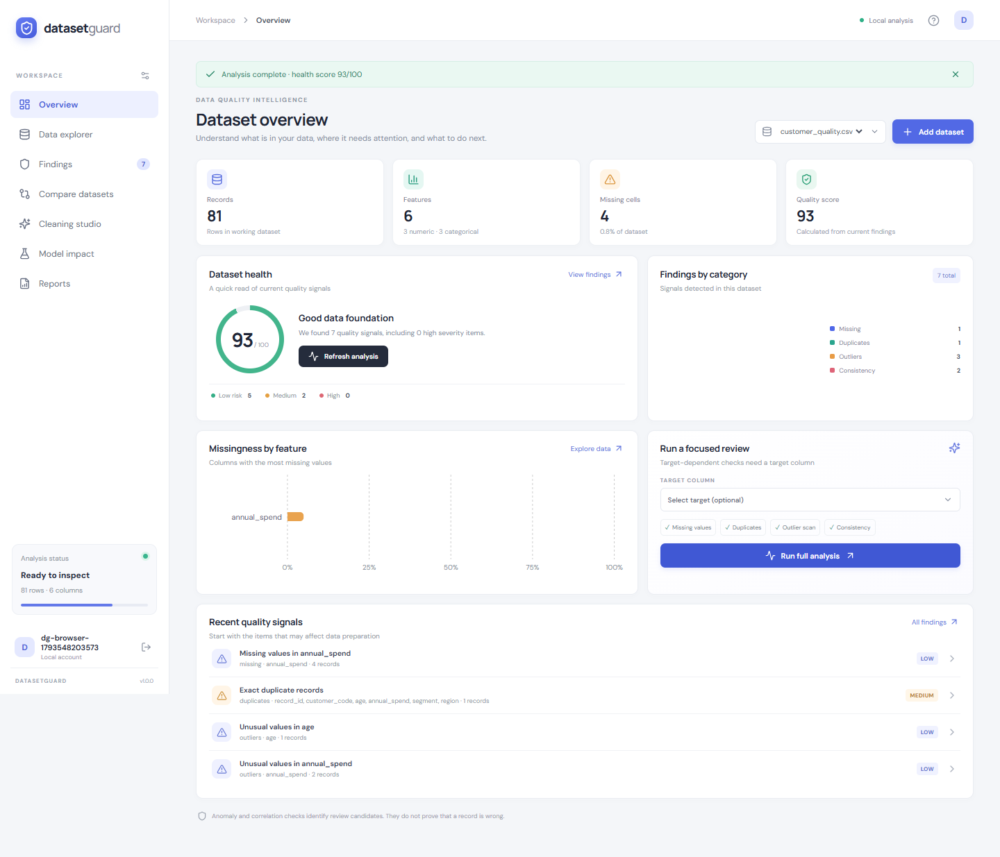

# DatasetGuard

**Dataset quality analysis, evidence, and controlled remediation — on your machine.**

DatasetGuard helps teams inspect tabular data, review evidence-backed quality findings, make reversible cleaning changes, compare dataset versions, and export audit artifacts. It runs locally with a React interface and a FastAPI API backed by SQLite and the local filesystem.



[View the screenshot gallery](#screenshots) · [Get started](#quick-start) · [Verification report](docs/FINAL_VERIFICATION.md)

## At a glance

- **Profile and explore:** inspect schemas, missingness, distinct values, numeric summaries, correlations, and paginated records.
- **Investigate:** run quality checks and review affected columns, row indices, evidence, recommendations, confidence, and limitations.
- **Remediate carefully:** apply supported cleaning operations to a working copy while preserving the original upload.
- **Compare versions:** review statistical distribution changes and exact record overlap.
- **Evaluate and report:** run a reproducible Random Forest baseline and export CSV data and PDF audit reports.

DatasetGuard is designed for local demonstrations and small to medium tabular datasets. Findings are review signals; users remain responsible for deciding whether a value is actually incorrect.

## Contents

- [Features](#features)
- [Screenshots](#screenshots)
- [Quick start](#quick-start)
- [Configuration](#configuration)
- [Using the sample data](#using-the-sample-data)
- [API overview](#api-overview)
- [Development and verification](#development-and-verification)
- [Project structure](#project-structure)
- [Data, privacy, and limitations](#data-privacy-and-limitations)

## Features

### Profiling and detection

- Ingest CSV, XLSX/XLS, JSON, and Parquet files (50 MB upload limit by default).
- Summarize types, missingness, uniqueness, numeric distributions, categorical values, and numeric correlations.
- Identify missing tokens, exact duplicate records, IQR outlier candidates, Isolation Forest candidates, whitespace and category variants, high numeric correlations, rare-label review cues, and target leakage candidates.
- Optionally review target class imbalance.
- Calculate a dataset health score from current findings and their severity and affected-record counts. The score is an operational summary, not a probability.

### Cleaning and comparison

- Impute missing values with a selected mean, median, or mode strategy.
- Remove exact duplicate rows and trim surrounding whitespace in text columns.
- Keep the original upload and apply cleaning to a working copy.
- Compare owned dataset versions with Kolmogorov–Smirnov tests for numeric features, chi-square tests and Jensen–Shannon effect sizes for categorical features, PSI for numeric features, and exact shared-record counts.

### Experiments and exports

- Fit a Random Forest baseline using a fixed 75/25 holdout split when the data permits.
- Export the current working dataset as CSV.
- Generate a PDF audit summary with profile metrics and current findings.

## Screenshots

Captured from the running application using real API data. Select an image to open it.

| Page | Screenshot |
|---|---|
| Registration and login | [Open](docs/screenshots/01-registration-login.png) |
| Dataset upload | [Open](docs/screenshots/02-dataset-upload.png) |
| Dashboard | [Open](docs/screenshots/03-main-dashboard.png) |
| Dataset profiling | [Open](docs/screenshots/04-dataset-profiling.png) |
| Detection findings | [Open](docs/screenshots/05-detection-findings.png) |
| Finding evidence | [Open](docs/screenshots/06-problem-details.png) |
| Cleaning studio | [Open](docs/screenshots/07-cleaning-studio.png) |
| Dataset comparison | [Open](docs/screenshots/08-dataset-comparison.png) |
| ML impact analysis | [Open](docs/screenshots/09-model-impact.png) |
| Reports and exports | [Open](docs/screenshots/10-reports.png) |
| Mobile data explorer (390 px) | [Open](docs/screenshots/11-mobile-layout.png) |

The PDF report is downloaded as a file; the application does not currently include an in-app PDF preview. Browser run details are recorded in [browser-qa-results.json](docs/screenshots/browser-qa-results.json).

## Quick start

### Prerequisites

- Python 3.10 or newer
- Node.js 20 or newer and npm
- Google Chrome is required only for the Playwright browser workflow

The project was verified with Python 3.10.6, Node.js 22.14.0, and npm 10.9.2. The commands below use PowerShell.

### 1. Start the API

Open a terminal at the project root:

```powershell
cd backend
python -m venv .venv
.\.venv\Scripts\Activate.ps1
python -m pip install -r requirements.txt
python -m uvicorn app.main:app --reload --host 127.0.0.1 --port 8000
```

The API is available at <http://127.0.0.1:8000>; interactive documentation is at <http://127.0.0.1:8000/docs>.

### 2. Start the web app

Open a second terminal at the project root:

```powershell
cd frontend
npm ci
npm run dev
```

Open <http://127.0.0.1:5173/>.

### 3. Create an account and load data

Register a local account. From the empty dashboard, choose **Customer quality** to load the sample dataset, or use **Add dataset** to upload a supported file. Run analysis to populate findings and charts.

## Configuration

The API reads these environment variables:

| Variable | Default | Description |
|---|---:|---|
| `DATASETGUARD_MAX_UPLOAD_MB` | `50` | Maximum upload size in megabytes |
| `DATASETGUARD_CORS_ORIGINS` | `http://localhost:5173,http://127.0.0.1:5173` | Comma-separated browser origins permitted by the API |

Set a variable in PowerShell before starting Uvicorn, for example:

```powershell
$env:DATASETGUARD_MAX_UPLOAD_MB = '50'
$env:DATASETGUARD_CORS_ORIGINS = 'http://localhost:5173,http://127.0.0.1:5173'
```

The frontend API URL is configured with `VITE_DATASETGUARD_API_URL`. It defaults to `http://127.0.0.1:8000/api`. To run the API on port 8001, start Uvicorn with `--port 8001` and set this variable before starting Vite:

```powershell
$env:VITE_DATASETGUARD_API_URL = 'http://127.0.0.1:8001/api'
npm run dev
```

For persistent frontend configuration, copy `frontend/.env.example` to `frontend/.env.local` and edit the value. Vite reads environment variables at startup, so restart the dev server after changing configuration.

Use `.env.example` and `frontend/.env.example` as configuration references. They are examples, not automatically loaded by the backend. If port 8000 is already in use, select another API port and point `VITE_DATASETGUARD_API_URL` to that same origin.

## Using the sample data

The included synthetic datasets demonstrate different review scenarios:

- **Customer quality:** missing values, a duplicate record, an age anomaly, and category variants.
- **Student performance:** missingness, target imbalance, and label case variants.
- **Classification:** label noise and an encoded feature that may reveal target leakage.

For a comparison demonstration, load the classification sample and upload `sample_datasets/classification_shifted.csv` as a second dataset. Open **Compare datasets** and run the comparison.

A typical walkthrough:

1. Load **Customer quality** and run analysis.
2. Review findings and open one to inspect row-level evidence.
3. Apply an imputation, duplicate removal, or whitespace trim in **Cleaning studio**.
4. Compare the original and cleaned copies.
5. Download the cleaned CSV and generate the PDF report.
6. Select `segment` as a target and run the baseline in **Model impact**.

## API overview

The FastAPI OpenAPI page at `/docs` lists request schemas and response details for every implemented route.

| Method | Route | Purpose |
|---|---|---|
| `POST` | `/api/auth/register`, `/api/auth/login`, `/api/auth/logout` | Local account and session operations |
| `GET` | `/api/me` | Current account |
| `POST` | `/api/datasets/upload` | Upload and profile a file |
| `POST` | `/api/datasets/demo` | Load a sample dataset |
| `GET` | `/api/datasets`, `/api/datasets/{id}` | List datasets and retrieve dataset detail |
| `GET` | `/api/datasets/{id}/records` | Read a page of dataset records |
| `POST` | `/api/datasets/{id}/analyze` | Run quality analysis, optionally with a target |
| `POST` | `/api/datasets/compare` | Compare `{ "reference_id": "...", "comparison_id": "..." }` |
| `POST` | `/api/datasets/{id}/clean` | Apply a supported cleaning action |
| `GET` | `/api/datasets/{id}/cleaning-history` | Read cleaning history |
| `GET` | `/api/datasets/{id}/export` | Download the current dataset as CSV |
| `POST` | `/api/experiments?dataset_id={id}` | Fit and save a baseline experiment |
| `GET` | `/api/experiments?dataset_id={id}` | Read experiment history |
| `POST` | `/api/reports/generate?dataset_id={id}` | Generate and download a PDF report |

## Development and verification

### Backend tests

From the project root:

```powershell
cd backend
python -m pip install -r requirements.txt -r requirements-dev.txt
python -m pytest -q
```

### Frontend production build

From the project root:

```powershell
cd frontend
npm ci
npm run build
```

### Browser end-to-end workflow

Start the API and Vite dev server first. Set `DATASETGUARD_API_URL` to the API origin used by the frontend, then run from `frontend/`:

```powershell
$env:DATASETGUARD_FRONTEND_URL = 'http://127.0.0.1:5173/'
$env:DATASETGUARD_API_URL = 'http://127.0.0.1:8000'
npm run qa:e2e
```

The workflow launches a fresh headless Chrome context and checks registration, sample loading, analysis, findings, evidence, cleaning, upload, comparison, ML evaluation, CSV/PDF downloads, login/logout, and the 390 px layout. It saves screenshots in `docs/screenshots/`. Set `DATASETGUARD_CHROME` if Chrome is installed at a non-default path.

### Recorded verification

The most recent results are in [docs/FINAL_VERIFICATION.md](docs/FINAL_VERIFICATION.md). That report records the backend test result, frontend build, browser diagnostics, bundle sizes, startup commands, and known limitations. Re-run the commands above after making changes; this README does not imply later changes have been verified.

## Project structure

```text
DatasetGuard/
├── backend/
│   ├── app/
│   │   ├── detectors/       # Profiling and detection logic
│   │   └── main.py           # FastAPI routes and application entry point
│   ├── data/                 # Local SQLite database
│   ├── storage/              # Uploaded files and working copies
│   ├── tests/                # Backend test suite
│   ├── requirements.txt
│   └── requirements-dev.txt
├── docs/
│   ├── screenshots/          # Browser QA screenshots and results
│   └── FINAL_VERIFICATION.md
├── frontend/
│   ├── public/
│   ├── scripts/browser-qa.mjs
│   ├── src/
│   ├── package.json
│   └── package-lock.json
└── sample_datasets/
```

## Data, privacy, and limitations

- SQLite is the local development database. Database files and uploaded data are stored locally under `backend/data/` and `backend/storage/`.
- Detection runs synchronously; there is no background job queue or progress service.
- The default upload cap is 50 MB. Parquet support uses PyArrow. Excel support depends on the installed Pandas Excel engines.
- The baseline model is a reproducible predictive benchmark; it does not estimate the causal effect of cleaning.
- Outlier, correlation, leakage, and model signals are candidates for human review, not proof of data error.
- This core release does not include DBSCAN/LOF, VIF, Cleanlab, SHAP, autoencoders, external AI assistance, password reset, or PostgreSQL deployment.
- Local password hashing and bearer sessions support local demonstrations. Before exposing the service to other users, add production-grade secret and session management, rate limiting, CSRF protections as appropriate, and a production data store.

## Roadmap ideas

Background analysis jobs, split-aware leakage checks, advanced multivariate detectors, configurable validation rules, PostgreSQL migrations, and repeated paired model experiments.
