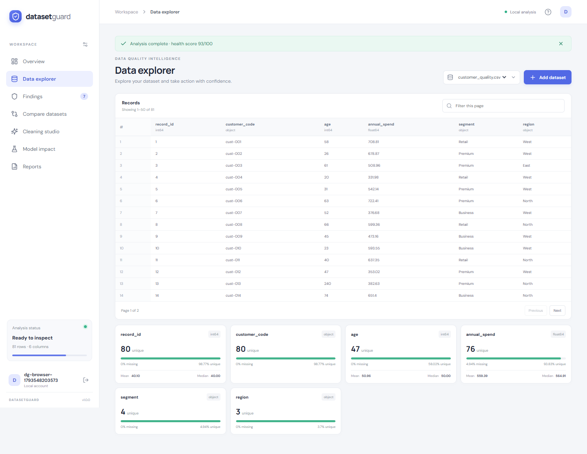
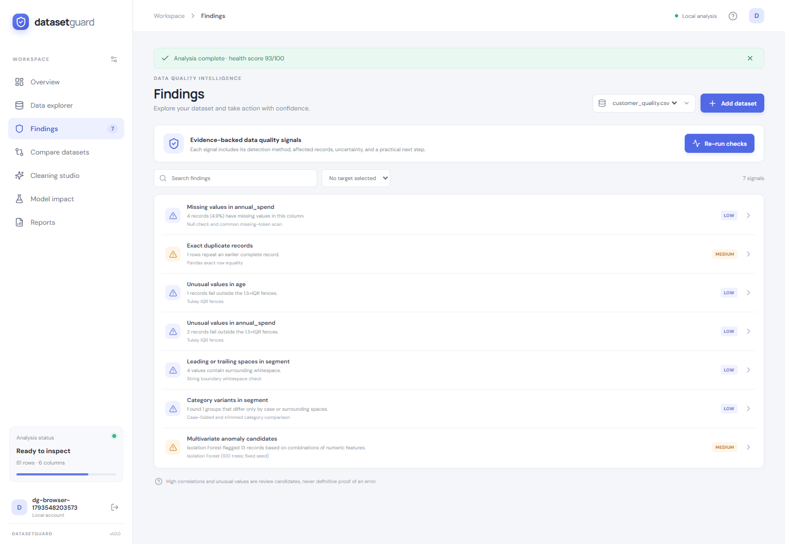
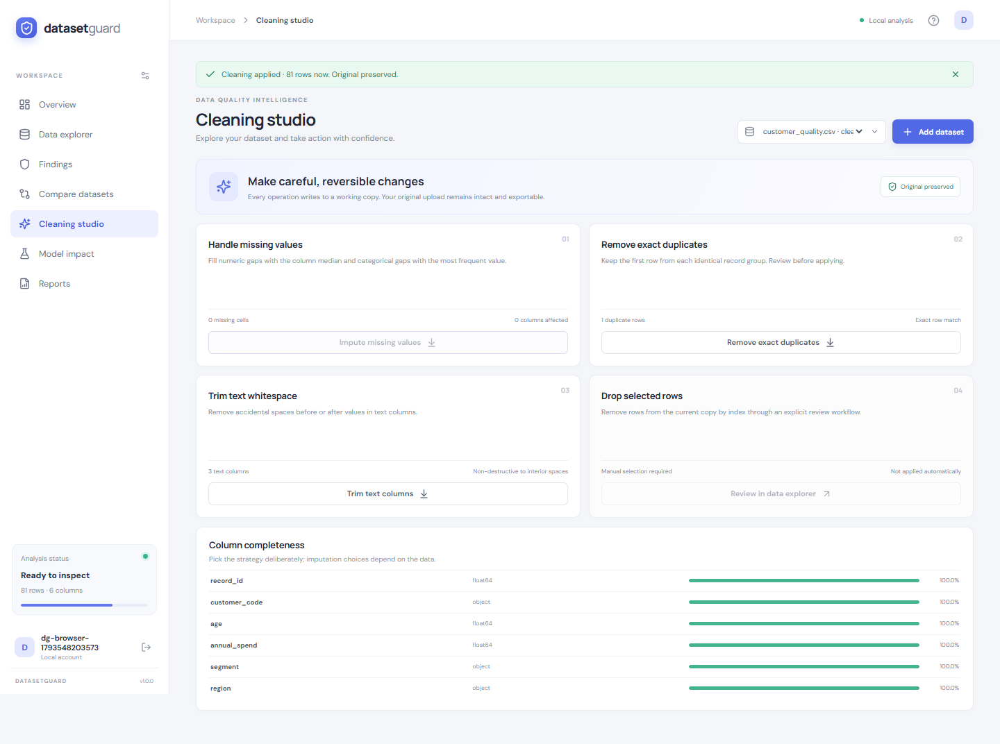
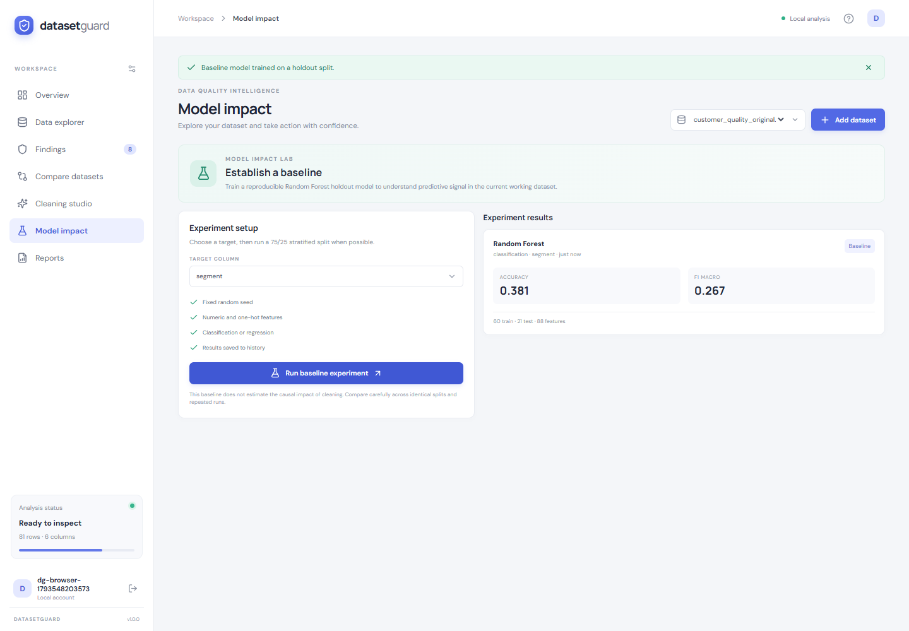
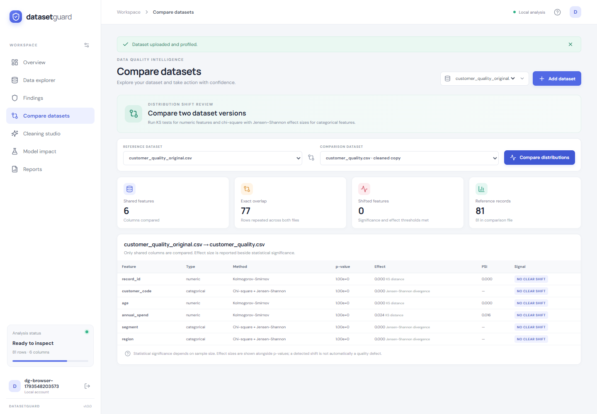
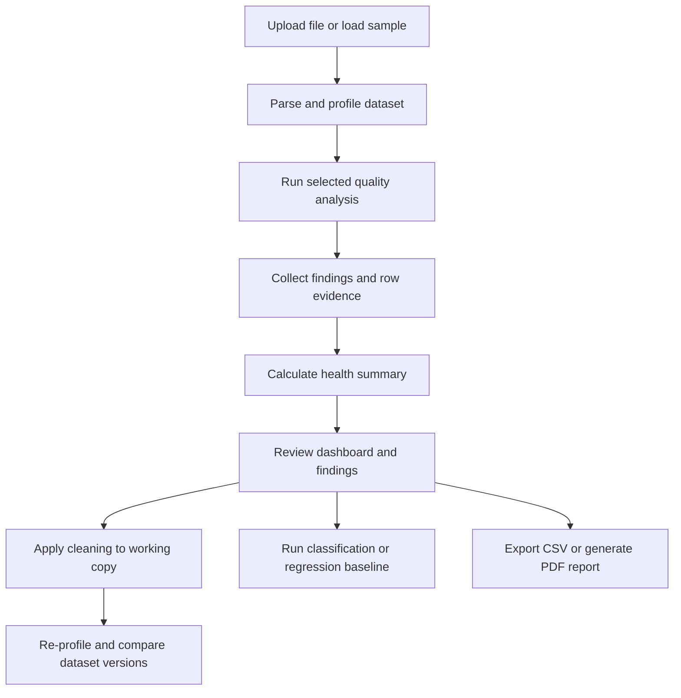
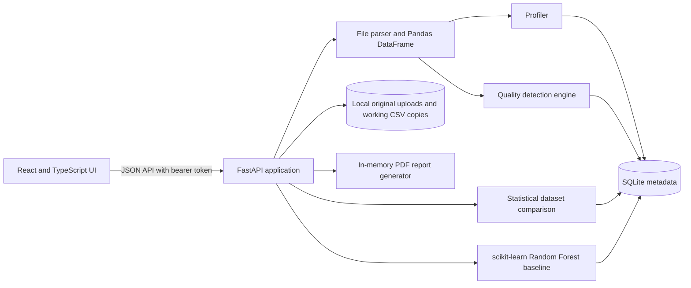

# DatasetGuard

### Detect. Diagnose. Improve. Trust Your Data.

[](https://www.python.org/)
[](https://react.dev/)
[](https://www.typescriptlang.org/)
[](https://fastapi.tiangolo.com/)
[](docs/FINAL_VERIFICATION.md)
[](docs/FINAL_VERIFICATION.md)

**DatasetGuard is a dataset quality and reliability analysis platform that identifies data quality issues, provides evidence-backed diagnostics, recommends corrective actions, and evaluates dataset signals with machine learning baselines.**

It helps data scientists, ML engineers, students, and software teams find issues before they undermine analysis or model training. Unlike a basic tabular viewer, DatasetGuard connects a profile to reviewable findings, affected rows, reversible cleaning actions, version comparisons, and downloadable audit artifacts.

The application runs locally. Its detectors combine statistical checks and scikit-learn models; it does not call an external AI service.

[Source repository](https://github.com/GirijaNayak/DatasetGuard) · [Quick start](#quick-start) · [Product preview](#product-preview) · [Verification report](docs/FINAL_VERIFICATION.md)

## Product preview

The screenshots below were captured from the running application with real backend data.

| Dashboard | Dataset profile |
|---|---|
| <a href="docs/screenshots/03-main-dashboard.png"></a> | <a href="docs/screenshots/04-dataset-profiling.png"></a> |

| Findings and evidence | Cleaning studio |
|---|---|
| <a href="docs/screenshots/05-detection-findings.png"></a> | <a href="docs/screenshots/07-cleaning-studio.png"></a> |

| ML baseline | Dataset comparison |
|---|---|
| <a href="docs/screenshots/09-model-impact.png"></a> | <a href="docs/screenshots/08-dataset-comparison.png"></a> |

[Registration and login](docs/screenshots/01-registration-login.png) · [Dataset upload](docs/screenshots/02-dataset-upload.png) · [Finding details](docs/screenshots/06-problem-details.png) · [Reports and exports](docs/screenshots/10-reports.png) · [Mobile view](docs/screenshots/11-mobile-layout.png)

## Contents

- [Overview](#overview)
- [Features](#features)
- [How it works](#how-it-works)
- [Architecture](#architecture)
- [Detection engine](#detection-engine)
- [Technology stack](#technology-stack)
- [Quick start](#quick-start)
- [Configuration](#configuration)
- [Usage guide](#usage-guide)
- [Sample datasets](#sample-datasets)
- [API documentation](#api-documentation)
- [Testing and verification](#testing-and-verification)
- [Project structure](#project-structure)
- [Current limitations](#current-limitations)
- [Roadmap](#roadmap)
- [Contributing](#contributing)
- [License](#license)

## Overview

Dataset quality affects every step after ingestion: summary statistics, feature engineering, training, evaluation, and decisions made from model output. Missing values, inconsistent categories, duplicate records, unexpected distributions, and suspicious feature-target relationships can distort those results.

DatasetGuard focuses on detecting and explaining such signals before model training. It joins a data explorer with quality checks that report their method and evidence. Users can review findings in context, make supported changes to a working copy, compare dataset versions, and produce exports for further analysis.

The system is intended for local evaluation, demonstrations, teaching, and small to medium tabular datasets. It emphasizes reviewability: an anomaly or statistical shift is a prompt for investigation, not proof that the data is wrong.

## Features

### Dataset management and profiling

- Upload CSV, XLSX, XLS, JSON, and Parquet files.
- Load the Customer Quality, Student Performance, and Classification training samples.
- Preview records and browse paginated data.
- Review per-column type, missingness, distinct-value counts, numeric summaries, categorical frequencies, and numeric correlations.
- Compare two datasets that belong to the signed-in account.

Profiling is computed during upload and when dataset detail is requested; there is no separate profile-job endpoint.

### Quality detection

- Nulls and common textual missing markers.
- Entirely empty columns.
- Exact duplicate rows.
- Univariate numeric outlier candidates using Tukey IQR fences.
- Multivariate numeric anomaly candidates using Isolation Forest.
- Leading/trailing whitespace and category variants differing by case or surrounding whitespace.
- High Pearson feature correlations.
- Optional target class imbalance, rare-label review cues, and feature-target leakage candidates.
- Dataset-level health score derived from finding severity and affected-record counts.

### Evidence and explainability

Findings include the method, affected columns, affected row indices where applicable, severity, a confidence value, evidence, a recommendation, and a note about uncertainty where appropriate. Confidence values are heuristic outputs, not calibrated probabilities. The health score is a prioritization summary, not a probability of correctness.

### Cleaning and exports

- Apply numeric mean or median imputation and categorical mode imputation through the cleaning API. The current UI imputation action uses median for numeric fields and mode for categorical fields.
- Remove exact duplicate rows.
- Trim surrounding whitespace from selected or detected text columns.
- Keep the original upload; cleaning writes a working CSV copy and records the operation.
- Export the current dataset copy as CSV.
- Generate a PDF audit summary with the current profile and saved findings.

The API also accepts an explicit `drop_rows` action. The current UI does not expose an active row-selection workflow for this operation.

### Machine learning evaluation

- Automatically choose a Random Forest classifier or regressor based on the selected target.
- Use a 75/25 train/test split with fixed random seed 41; classification is stratified when possible.
- Report accuracy and macro F1 for classification, or R² and mean absolute error (MAE) for regression.
- Save experiment results to history.

Experiment history is available, but the UI does not provide a comparative model leaderboard. The baseline is not a causal estimate of cleaning impact.

### Dataset comparison

- Compare numeric features with the two-sample Kolmogorov-Smirnov test and report PSI as an additional distribution measure.
- Compare categorical features with a chi-square test and Jensen-Shannon divergence.
- Show p-values alongside effect measures and apply significance and effect thresholds to the changed-feature indicator.
- Count exact shared records across common columns, including duplicate multiplicity.

Statistical significance depends on sample size. A reported shift does not automatically indicate a data quality defect.

### Reporting

- Download a CSV of the current original or cleaned dataset.
- Generate a PDF audit summary with the dataset profile, health score, and findings.
- The PDF is downloaded as a file; there is no in-app PDF preview.

## How it works



The analysis is synchronous. Upload and dataset detail return profile data; the user starts quality analysis explicitly from the application.

## Architecture



The browser talks to FastAPI over HTTP. Pandas handles file parsing and tabular transformations. SQLite stores local account, dataset, cleaning-operation, and experiment metadata. Uploaded files and cleaned CSV copies are kept on disk under `backend/data/uploads/`. The API scopes dataset access to the authenticated user. There are no message queues, cloud services, or external AI integrations.

## Detection engine

The checks are implemented in `backend/app/detectors/engine.py`. They identify candidates for review and intentionally avoid labeling statistical anomalies as confirmed errors.

| Detector | Method and trigger | Evidence returned | Why review it |
|---|---|---|---|
| Missing values | Null scan plus normalized scan for common textual tokens such as `na`, `null`, `?`, and `-` | Count, percentage, tokens, affected row indices, severity | Missingness can change sample composition and model behavior; choose whether to impute, retain, or investigate |
| Entirely empty column | Column completeness check when all values are null | Non-missing count and affected rows | The field may be unusable or indicate an ingestion problem |
| Exact duplicates | Pandas full-row equality; later repeats are flagged | Duplicate count, groups, row indices | Accidental repeats can overweight records and bias summaries |
| Univariate outlier candidates | Tukey fences at 1.5 × IQR for numeric columns with sufficient observations and variation | Q1, Q3, lower/upper fences, count, row indices | Extreme values can be errors or valid rare cases; domain context is required |
| Multivariate anomaly candidates | `StandardScaler` followed by a 100-tree `IsolationForest` with fixed seed 17; numeric missing values are median-filled for this check | Candidate rows, sample anomaly scores, review threshold, feature list | Unusual combinations may be missed by one-column checks; the score indicates rarity, not incorrectness |
| Whitespace variants | String boundary check for leading/trailing whitespace | Affected values and row indices | Stray spaces can create distinct categories or failed joins |
| Category variants | Trimmed, case-folded comparison for nonnumeric columns with at most 100 distinct values | Variant groups and affected rows | Equivalent labels may split counts or classes |
| High feature correlation | Pearson correlation with absolute value at least 0.95 | Feature pair and correlation value | May signal redundant features or a domain relationship; it does not prove leakage |
| Target class imbalance | Optional target frequency ratio; triggered when the largest class is at least 2× the smallest | Per-class counts and ratio | Imbalance affects split strategy and interpretation of aggregate metrics |
| Rare target labels | Optional target-frequency scan for classes with at most `max(2, 1% of rows)` examples | Rare-class counts and affected rows | Small classes may be valid but hard to evaluate reliably |
| Numeric target association | For numeric targets, Pearson feature-target correlation scan at absolute value at least 0.98 | Correlation and paired-row count | Strong associations warrant provenance and prediction-time checks |
| Binary target separation | For binary targets, a single numeric threshold scan; candidate emitted at at least 95% in-sample accuracy | Threshold, accuracy, paired-row count | A feature may encode or proxy the target; the in-sample scan is not proof of leakage |
| Categorical target association | For targets with at least 30 observations, scan low-cardinality features for within-value target purity of at least 0.995 | Purity and paired-row count | Near-deterministic mappings may be valid or may expose target-derived information |

Isolation Forest is bounded to up to 30 numeric features and 50,000 rows. The implementation uses a fixed seed for reproducibility. Detector thresholds are heuristics; results require domain review.

### Comparison methods

| Feature type | Statistical test | Effect measure |
|---|---|---|
| Numeric | Two-sample Kolmogorov-Smirnov | KS distance and PSI |
| Categorical | Chi-square contingency test | Jensen-Shannon divergence |

The changed-feature flag requires both a p-value threshold and a minimum effect threshold. Exact overlap is computed separately across columns shared by both files.

## Technology stack

| Area | Technologies |
|---|---|
| Frontend | React 18, TypeScript 5, Vite |
| Components and charts | Custom responsive CSS, Recharts, Lucide React |
| API | FastAPI, Uvicorn, Pydantic |
| Data processing | Pandas, NumPy |
| Statistics and machine learning | SciPy, scikit-learn |
| File formats | OpenPyXL for Excel; PyArrow for Parquet |
| Persistence | SQLite and local filesystem; Python standard library `sqlite3` |
| Testing | pytest, Python `unittest`, Playwright with Google Chrome |

Pinned backend dependencies are listed in `backend/requirements.txt`; the frontend dependency lockfile is `frontend/package-lock.json`.

## Quick start

### Prerequisites

- Python 3.10 or newer
- Node.js 20 or newer and npm
- Google Chrome only if you plan to run browser end-to-end verification

The recorded local verification used Python 3.10.6, Node.js 22.14.0, and npm 10.9.2. Commands are shown for Windows PowerShell and Linux/macOS.

### Backend

**Windows PowerShell**, from the project root:

```powershell
cd backend
python -m venv .venv
.\.venv\Scripts\Activate.ps1
python -m pip install -r requirements.txt
python -m uvicorn app.main:app --reload --host 127.0.0.1 --port 8000
```

**Linux or macOS**, from the project root:

```bash
cd backend
python3 -m venv .venv
source .venv/bin/activate
python -m pip install -r requirements.txt
python -m uvicorn app.main:app --reload --host 127.0.0.1 --port 8000
```

### Frontend

Open a second terminal at the project root:

```bash
cd frontend
npm ci
npm run dev
```

The Vite development server binds to `127.0.0.1:5173`.

### Run with Docker

Docker Compose is also configured:

```bash
docker compose up --build
```

Open <http://localhost:8080/>. The Compose API is published on port 8000. See `docker-compose.yml` for the local volume and CORS settings.

## Running the application

| Service | Default address |
|---|---|
| Frontend | <http://127.0.0.1:5173/> |
| Backend API | <http://127.0.0.1:8000/> |
| OpenAPI / Swagger UI | <http://127.0.0.1:8000/docs> |
| Health check | <http://127.0.0.1:8000/api/health> |

If port 8000 is already in use, run Uvicorn on an available port and set the frontend API base before starting Vite. For example, in PowerShell:

```powershell
# Backend terminal
python -m uvicorn app.main:app --reload --host 127.0.0.1 --port 8001

# Frontend terminal
$env:VITE_DATASETGUARD_API_URL = 'http://127.0.0.1:8001/api'
npm run dev
```

Vite reads `VITE_DATASETGUARD_API_URL` at startup. Restart Vite after changing it.

## Configuration

| Variable | Used by | Default | Purpose |
|---|---|---|---|
| `DATASETGUARD_MAX_UPLOAD_MB` | Backend | `50` | Maximum permitted upload size in megabytes |
| `DATASETGUARD_CORS_ORIGINS` | Backend | `http://localhost:5173,http://127.0.0.1:5173` | Comma-separated allowed browser origins |
| `VITE_DATASETGUARD_API_URL` | Frontend | `http://127.0.0.1:8000/api` | API base URL read by Vite |

The root `.env.example` documents backend settings; `frontend/.env.example` documents the frontend API URL. The backend reads operating-system environment variables directly and does not automatically load a root `.env` file. PowerShell example:

```powershell
$env:DATASETGUARD_MAX_UPLOAD_MB = '50'
$env:DATASETGUARD_CORS_ORIGINS = 'http://localhost:5173,http://127.0.0.1:5173'
```

For persistent frontend configuration, copy `frontend/.env.example` to `frontend/.env.local`, then restart Vite.

## Usage guide

1. Start the API and frontend.
2. Register an account or log in.
3. Choose **Customer quality** to load the sample, or upload a supported file.
4. Inspect the returned profile, preview, and records in **Data explorer**.
5. Run analysis from the dashboard.
6. Review finding categories, severity, methods, and recommendations.
7. Open an individual finding to inspect its evidence and affected rows.
8. Apply imputation, duplicate removal, or whitespace trimming in **Cleaning studio**.
9. Select original, cleaned, or uploaded dataset versions in **Compare datasets**.
10. Select a target and run the Random Forest baseline in **Model impact**.
11. Download the current CSV or generate a PDF audit report from **Reports**.
12. Sign out using the account control in the sidebar.

Cleaning updates the working copy. The original upload remains available for comparison and export.

## Sample datasets

All sample files are synthetic. `sample_datasets/ground_truth.json` documents their intended issues.

| Dataset | Shape | Demonstrates | How to load |
|---|---:|---|---|
| `customer_quality.csv` | 81 × 6 | Missing `annual_spend`, exact duplicate, age outlier candidate, case/whitespace category variant in `segment` | Choose **Customer quality** in the app |
| `student_performance.csv` | 100 × 5 | Missing `exam_score`, class imbalance when `result` is the target, capitalization variants | Choose **Student performance** in the app |
| `classification_train.csv` | 120 × 5 | Three injected label-noise rows and `target_encoded = signal_a + signal_b`, a direct leakage candidate | Choose the classification sample in the app |
| `classification_shifted.csv` | 40 × 5 | Deliberately shifted feature distribution relative to the training sample | Upload from `sample_datasets/` and compare with the training sample |

The demo-load API accepts the first three files. The shifted classification file is loaded by uploading it.

## API documentation

The interactive OpenAPI page is available at <http://127.0.0.1:8000/docs>. All dataset and experiment routes require a bearer token obtained through registration or login.

### Authentication

| Method | Endpoint | Purpose |
|---|---|---|
| `POST` | `/api/auth/register` | Create a local account |
| `POST` | `/api/auth/login` | Start a session |
| `POST` | `/api/auth/logout` | End the current session |
| `GET` | `/api/me` | Return the current account |

### Dataset management and profiling

| Method | Endpoint | Purpose |
|---|---|---|
| `GET` | `/api/health` | Service health |
| `POST` | `/api/datasets/upload?filename=...` | Upload a file and return its profile and preview |
| `POST` | `/api/datasets/demo` | Load a supported demo sample and return its profile |
| `GET` | `/api/datasets` | List the current user’s datasets |
| `GET` | `/api/datasets/{dataset_id}` | Get dataset detail, profile, findings, and preview |
| `GET` | `/api/datasets/{dataset_id}/records?offset=0&limit=50` | Get a page of records |

Profiling is computed as part of upload and dataset-detail responses; a separate profile route is not implemented.

### Detection and comparison

| Method | Endpoint | Purpose |
|---|---|---|
| `POST` | `/api/datasets/{dataset_id}/analyze` | Run checks, optionally supplying a target column |
| `POST` | `/api/datasets/compare` | Compare two owned datasets |

### Cleaning

| Method | Endpoint | Purpose |
|---|---|---|
| `POST` | `/api/datasets/{dataset_id}/clean` | Apply `impute`, `drop_duplicates`, `trim`, or `drop_rows` to a working copy |
| `GET` | `/api/datasets/{dataset_id}/cleaning-history` | Read logged cleaning operations |

The API supports `drop_rows`; the current frontend does not provide an active row-selection flow for it.

### Model evaluation and reporting

| Method | Endpoint | Purpose |
|---|---|---|
| `POST` | `/api/experiments?dataset_id={id}` | Fit and save a classification or regression baseline |
| `GET` | `/api/experiments?dataset_id={id}` | Read experiment history |
| `GET` | `/api/datasets/{dataset_id}/export` | Download the current dataset as CSV |
| `POST` | `/api/reports/generate?dataset_id={id}` | Generate and download a PDF audit report |

## Testing and verification

### Backend automated tests

Run from the project root:

```bash
cd backend
python -m pip install -r requirements.txt -r requirements-dev.txt
python -m pytest -v
```

**Recorded result: 5 passed.** The suite covers detector behavior, dataset comparison, sample loading, and an upload → analyze → clean → model → CSV → PDF workflow.

### Frontend production build

From the project root:

```bash
cd frontend
npm ci
npm run build
```

**Recorded result: passed.** TypeScript compilation and the Vite production build completed.

### Browser and API integration

Browser-level verification **was completed** with Google Chrome and Playwright using a fresh browser context. The workflow covered registration and login, sample Customer Quality load and profiling, dashboard charts, findings and evidence, cleaning, CSV upload, comparison, baseline evaluation, CSV and PDF downloads, logout, and the mobile layout.

The recorded run had no unexpected console errors, page errors, failed requests, or HTTP error responses. A 401 from the intentional wrong-password check was expected. The 390 px responsive check passed. The browser comparison returned six shared columns and 77 exact shared records.

See [docs/FINAL_VERIFICATION.md](docs/FINAL_VERIFICATION.md) for the complete run record, bundle measurements, screenshots, and exact commands. The status badges above reflect this recorded local run; they are not CI badges.

### Re-run browser workflow

Start both services first. Set `DATASETGUARD_API_URL` to the running API origin, then run from `frontend/`:

```powershell
$env:DATASETGUARD_FRONTEND_URL = 'http://127.0.0.1:5173/'
$env:DATASETGUARD_API_URL = 'http://127.0.0.1:8000'
npm run qa:e2e
```

The workflow requires Google Chrome. Set `DATASETGUARD_CHROME` if Chrome is installed at a non-default location. It saves screenshots and JSON results under `docs/screenshots/`.

## Project structure

```text
DatasetGuard/
├── backend/
│   ├── app/
│   │   ├── detectors/engine.py  # Profiling, detection, and comparison
│   │   └── main.py              # API, persistence, cleaning, models, reports
│   ├── tests/                   # Backend tests
│   ├── data/                    # Runtime SQLite database and uploaded files
│   ├── requirements.txt
│   └── requirements-dev.txt
├── docs/
│   ├── screenshots/             # Browser captures and QA results
│   ├── ARCHITECTURE.md
│   └── FINAL_VERIFICATION.md
├── frontend/
│   ├── public/
│   ├── scripts/browser-qa.mjs
│   ├── src/
│   ├── package.json
│   └── package-lock.json
├── sample_datasets/
│   ├── ground_truth.json
│   └── *.csv
├── .env.example
├── docker-compose.yml
└── README.md
```

## Current limitations

- Detection and model analysis run synchronously; there is no background job queue.
- The default upload cap is 50 MB.
- The deferred chart chunk is 401.67 kB minified; chart lazy loading reduces the initial app JavaScript from 595.02 kB to 194.58 kB while retaining all chart features.
- PDF reports can be generated and downloaded, but there is no in-app PDF preview.
- The model baseline does not estimate the causal impact of cleaning and there is no comparative model leaderboard.
- `drop_rows` is accepted by the cleaning API but has no active row-selection UI.
- DBSCAN/LOF, Cleanlab, SHAP, VIF, autoencoders, PostgreSQL deployment, password reset, and external AI assistance are not implemented.
- The project has no CI workflow configured. The badges report local verification recorded in `docs/FINAL_VERIFICATION.md`.
- Local account and bearer-session handling is intended for demonstrations. Before multi-user or internet-facing deployment, add production-grade session management, rate limiting, appropriate CSRF protections, and storage controls.
- No project license has been specified; see [License](#license).

## Roadmap

### Completed

- Local account flow and user-scoped dataset storage.
- Upload, preview, profile, findings with evidence, and statistical/model review checks.
- Working-copy cleaning, dataset comparison, model baselines, and CSV/PDF exports.
- Production frontend build and browser-level workflow verification.

### In progress

No additional roadmap item is currently tracked as in progress.

### Planned

- Background processing and progress reporting for larger files.
- Advanced anomaly detection and adaptive detection thresholds.
- Label-error review with Cleanlab and model explanations with SHAP.
- Split-aware leakage checks and expanded data-drift monitoring.
- Broader detector and frontend automated test coverage.
- PostgreSQL support and repeated paired model experiments.

Genetic-algorithm-based optimization is a possible research direction, not a current feature.

## Contributing

Contributions are welcome. Before opening a pull request:

1. Fork the repository and create a focused feature branch.
2. Keep changes modular and consistent with the existing frontend/API/detector boundaries.
3. Add or update tests for new detectors, API behavior, and cleaning or comparison logic.
4. Run `python -m pytest -v` from `backend/` and `npm run build` from `frontend/`.
5. Include a clear description, verification steps, and screenshots for visible UI changes.

Please open an issue first for substantial changes to algorithms or application scope.

## License

No `LICENSE` file is currently present in the repository. A project license has not yet been specified.

---

DatasetGuard aims to make dataset reliability easier to inspect, explain, and improve before data problems compromise machine learning workflows.
